# Le Coque's Casino: game guide

*Le Coque's Casino by LeCoqueEnRose.*

**Basics.** Swap your scrap for chips at the cage (ground floor, 100 % of its value). Take a chip stack at the window (E);
left click changes the chip value. At any game, **E** bets a chip and **Q** takes the last one back while bets are open.
**Y / U / I** are shortcuts for the first, second and third option of the game in front of you. Every game has a rule card
(pick it up, **Z** to bring it close). Seated at poker, blackjack or sic bo, **Z** zooms in on the table. Cash out at the cage for credits (at the Company's rate of the day) or a voucher.

"Pays 1 to 1": bet 10, take home 20. "×5": bet 10, take home 50, your bet included. Only three games have a jackpot: the
high-grade slots, the big wheel's GOLD and the Vault Tower's megapot.

---

## Ground floor

### Chip cage
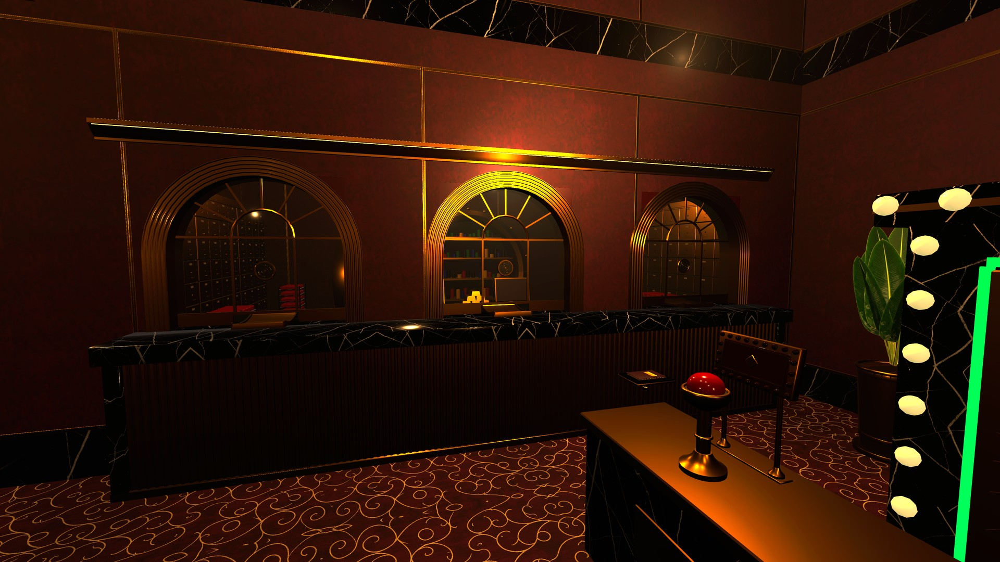
Drop scrap on the tray (or E holding it) to fill your chip account; take chips out at the window (each player sees their
own balance, at any of the three windows, at the same time); cash out for credits or a
voucher when you leave. No fee: only the games win or lose.

### Slot machines (8 themes)
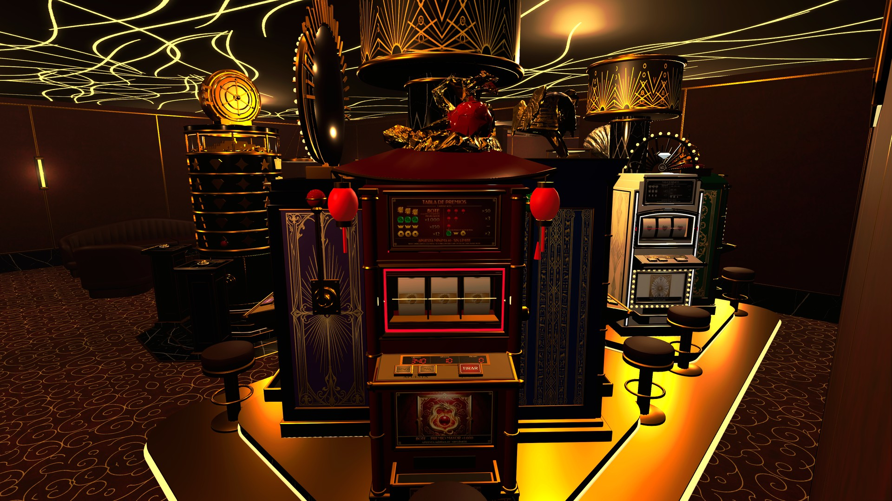
Sit at a machine with your stack in hand. **E** on plus/minus sets the bet, **E** on the spin button or the lever spins.
You're paid on the center line.
- **Low grade** (ocean, sevens, fruits): bet 1-25, wins often, top ×100.
- **Medium** (diamonds, safe, wheel slot): bet 5-100, top ×500.
- **High** (jewels, dragon, Egypt): bet 10 and up, top ×1,000, and **3 shining symbols in view = the slots jackpot**
  (1 in 394 spins; all of it if you bet 1 chip per 20 in the pot).
All return about 96 of every 100 chips.

### Wheel slot
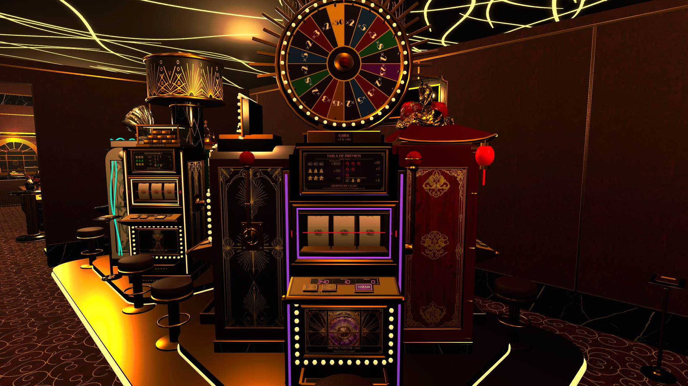
Medium-grade slot (bet 5-100). If WHEEL lands on reel 3 (1 in 22 spins), the top wheel spins and multiplies your bet ×2 to
×50, on top of the line win. No jackpot.

### Mega Machine
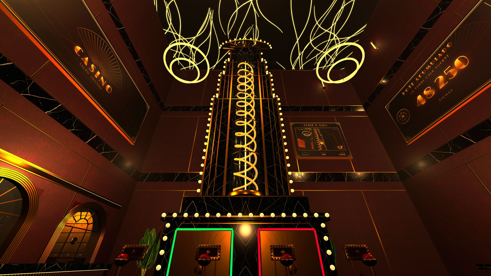
You bet the Company **quota**, not chips. Once per deadline, before the last day: every player holds **E** for 1 s on their
lever (60 s limit). The ball drops into the **green** mouth (quota met, 40 %) or the **red** one (quota doubled, 60 %).
On the last day of the deadline the Mega Machine is closed.

### Plinko
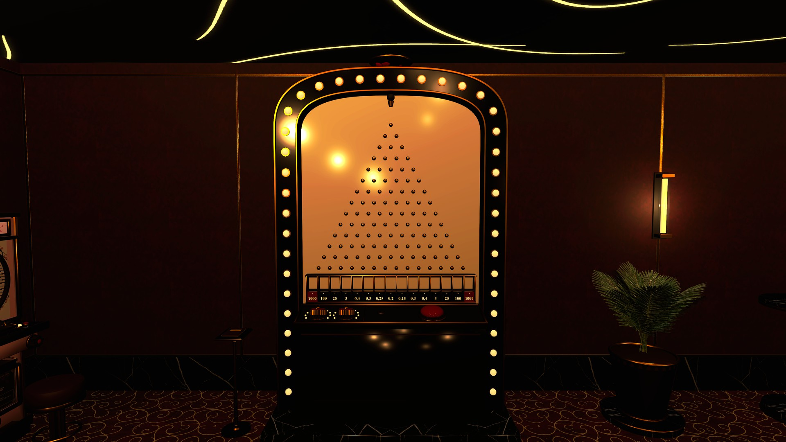
Each ball is worth your chip. **E** on the knobs sets how many balls (left +10, right +1; Q lowers), **E** on the ruby button
launches. Slots pay ×1000 (corners, 1 in 8,192), ×100, ×25, ×3, and less toward the center (×0.2 in the middle). Returns ~96 %.

### Pachinko (4 machines)
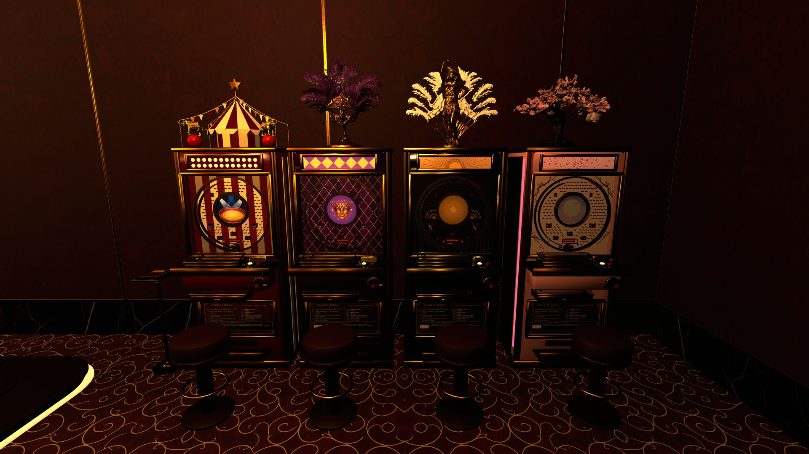
Buy balls on the tray (**E**, 1 ball = 1 chip), shoot with **E** on the handle (hold for nonstop). Side pocket +3 balls,
tulip +4, center pocket +3 and spins the screen: **7 7 7 = FEVER** (1 in 36 spins: the big gate opens 3 times, 10 balls
each paying 10). After fever, half the time you get "high chance". **Q** on the tray cashes your balls back into chips.

### Bell jar bingo
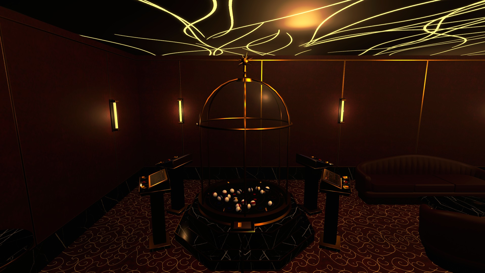
1-4 players standing. Pick one of the cards on your console, bet with **E** (the first bet starts 20 s for everyone). Five
balls drop onto the board: 3 of your symbols ×3, 4 symbols ×20, **5 symbols ×250** (the bingo's jackpot). A ball on the
center sun doubles your prize. **E** on the right dish repeats your bet.

### Shell game
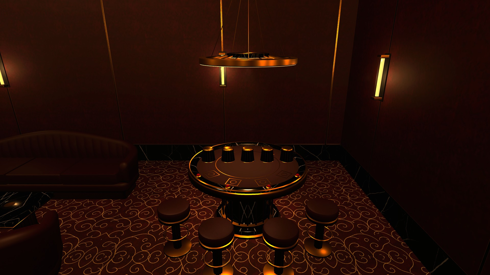
1-4 seated. Bet before it starts (20 s, or sooner if everyone presses ready). A cup covers the ball and the 5 cups shuffle.
When they stop, look at your cup and press **E** (10 s, your pick is secret). Right cup pays **×5**. Follow the ball well and
the house loses.

### Vault Tower
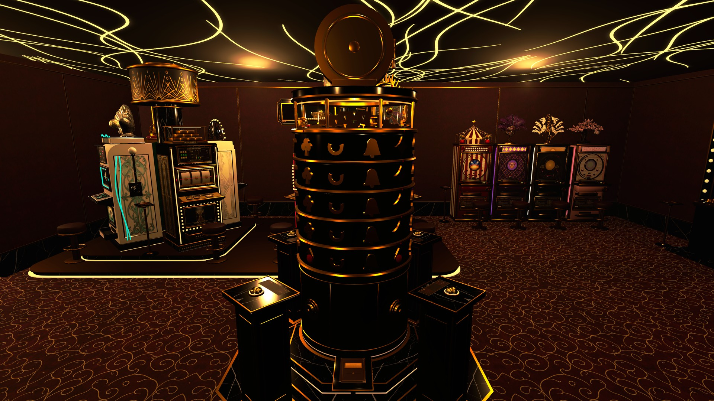
1-4 players, one high table each. **E** to join (100 chips per attempt). On your turn, **E** stops your ring with the gold
crown over your table's ruby (each ring has a crown facing every table). Lock it and the next ring spins faster; miss once and the attempt is over. Lock all 4 to win
the **megapot** (split evenly in a group, where it's a bit easier). The megapot grows with every chip the casino wins and
survives getting fired.

---

## 1st floor

### Roulette
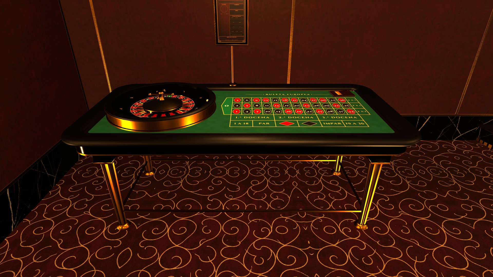
Up to 6 standing. Look at a spot on the layout and press **E** (hold for several chips). The first chip starts 20 s; READY
on the table edge speeds it up. Straight up 35 to 1, split 17, street 11, corner 8, six line 5, dozen/column 2, red/black,
odd/even, 1-18/19-36 1 to 1 (half back on 0). REPEAT places your last bet again.

### Craps
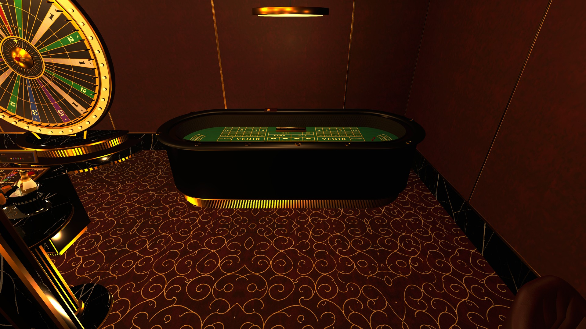
Up to 8 standing. Bet on the layout with **E**. The dice float to the shooter, chosen in turn: grab them with **E**, aim, hold
click for power, release. Come-out: 7 or 11 wins the pass line, 2/3/12 loses; any other number is the point, roll it again
before a 7. Also don't pass, odds (true odds), lay, field, hardways and one-roll bets (2 or 12 pay 30 to 1). Best bet: pass
line + odds.

### Blackjack
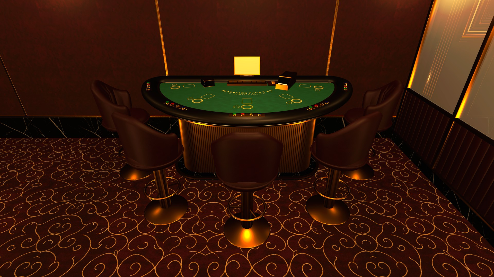
Sit with **E**, bet on your circle. On your turn: hit (green), stand (red), double (gold), split (blue). The house hits to 16
and stands on 17. Win 1 to 1, blackjack 3 to 2, push returns your bet. With the basic strategy card the house keeps 0.41 %.

### Sic bo
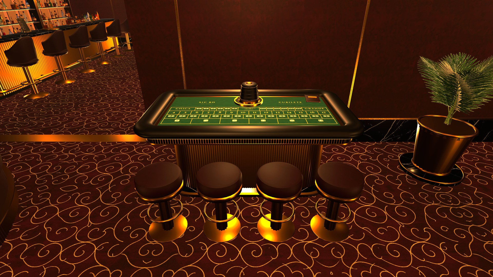
Bet on the layout (20 s from the first chip). The three dice float into the cup, it shakes in the air, slams down on its
plate and lifts gently. Small/big 1 to 1,
single number 1-3 to 1 (×12 on a triple), two-dice combo 6 to 1, specific double 12 to 1, any triple 34 to 1, specific
triple 209 to 1, exact totals 6.5-69 to 1.

### Baccarat
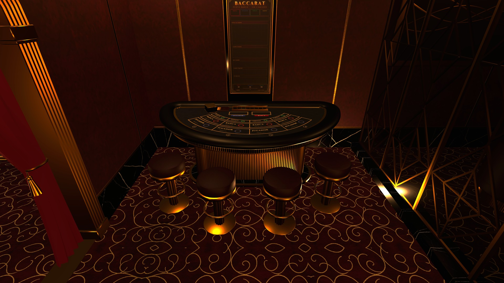
Sit and bet with **E** on Player (blue), Banker (red) or Tie (green). The cards deal themselves; the hand closest to 9 wins
(only the last digit counts). Player 1 to 1, Banker 1 to 1 (a 3-card 7 win is a push), Tie 9 to 1. Banker is the best bet.

### Poker
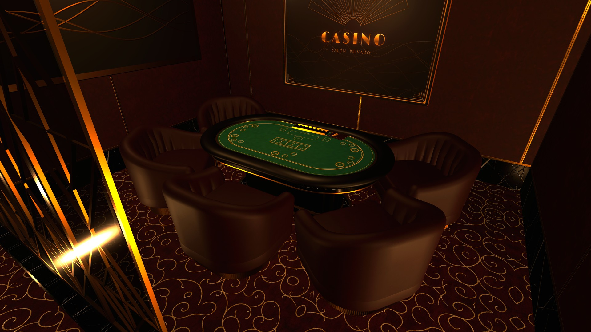
1-5 in armchairs. The burgundy lever totem at the end of the screen picks the opponent (up: the house; down: your crew) and
the dealer's tablet picks the game, between hands.
- **Against your crew** (no house cut). In every game: check, bet, call, raise, fold or all in; the winning hand glows and the
  pot flies to it.
  - **Draw poker**: everyone votes the ante (the 25 / 50 / 100 signs rise from the felt; a tie is drawn at random). 5 hidden
    cards, a betting round, swap the ones you want, a second round, showdown.
  - **Texas Hold'em**: the player with the D chip picks the big blind (25 or 50) and the next player pays it. 2 hidden cards;
    preflop, flop, turn and river.
  - **Coque's choice**: voted ante; 5 cards each and 5 face up in the middle. After the first round, on your one swap turn,
    trade up to 3 of your cards with the middle (**E** on yours, then **E** on one in the middle) to build your best hand;
    what you leave there is up for grabs. Only your own 5 cards count.
- **Against the house**:
  - **Hold'em vs the dealer**: ante; see your 2 cards and the flop, then fold or pay 2× the ante for the turn and river. The
    dealer needs a pair of fours or better: if not, your ante wins and the call comes back. Ante bonus from a straight up.
  - **Coque's choice vs the house**: bet, swap up to 3 cards with the middle, then the dealer makes the swaps that best improve
    its hand, in plain sight. Best own 5-card hand wins, paid 1 to 1 minus a 5 % commission.
- Everyone sees the bets: "<name> RAISES TO 20" at the top, what each player has in the round next to their circle, and the pot
  and the amount to call in the middle. Seated at poker, blackjack or sic bo, **Z** zooms in.

### Big wheel
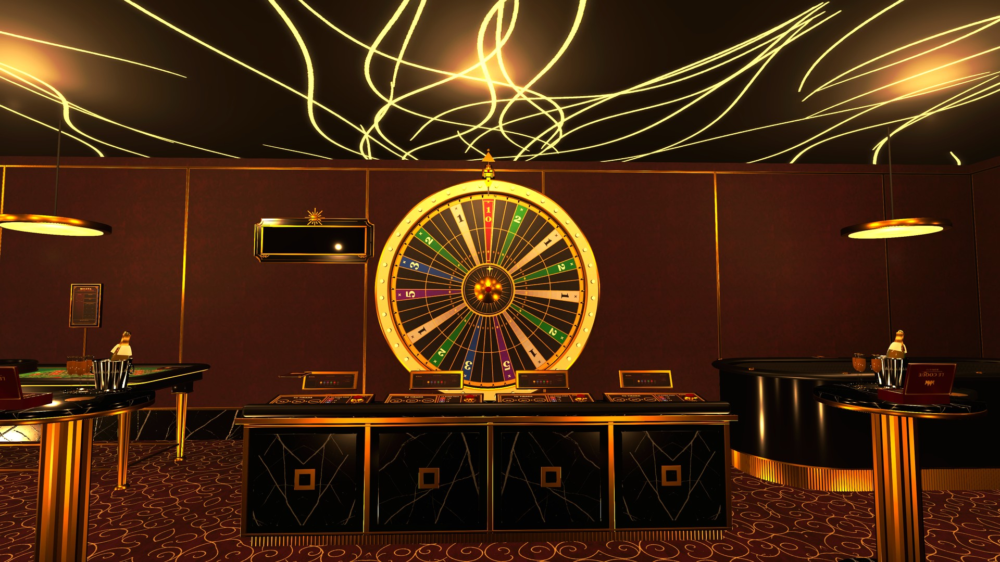
4 spots standing. **E** on your layout pays a 25 spin; more **E** raises it to 50 or 100. Ready (or 15 s) and it spins: your
spin times the number under the flapper (×10, ×5, ×3, ×2, ×1 or nothing). **GOLD** (1 in 360 spins) pays the gold jackpot:
all of it with a 100 spin, half with 50, a quarter with 25.

### Keno
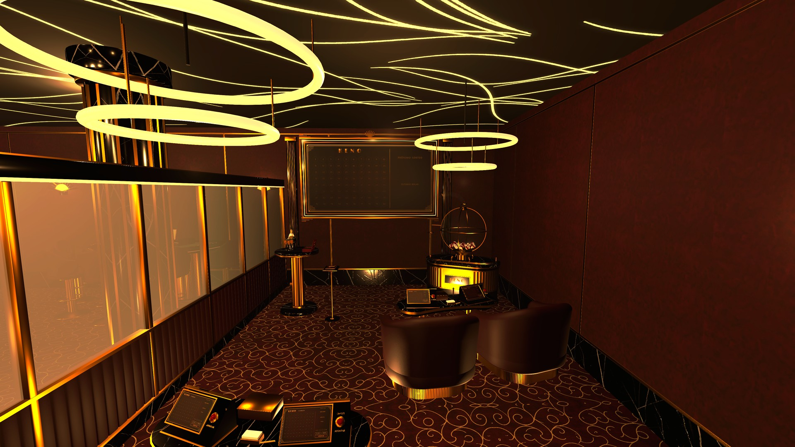
4 armchairs with consoles. **E** opens your console; mark 1-10 of the 80 numbers with the mouse (or quick pick), set bet and
rounds and press BET. Every 2 minutes 20 balls are drawn. Catch them all: 1 spot ×3.8, 2 ×15.5, 4 ×150, 6 ×2,000, 8 or 10
×10,000. Marking 8 is the best value.

---

## 2nd floor

### Horse race
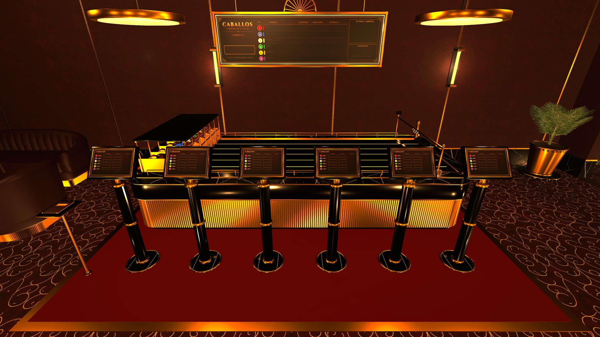
Stand at a tablet: 6 horses and their odds. **E** on "win" or "place" for a horse (30 s to bet). 12-15 s of racing, photo
finish on close calls. You're paid the odds shown when you bet: favourite ~×1.7, long shot up to ×13.

### Crash
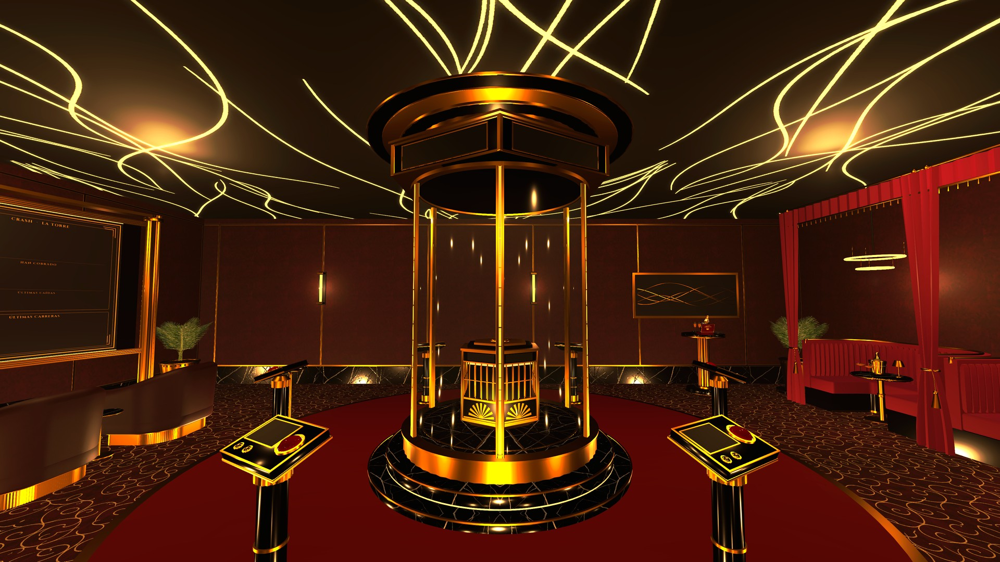
Up to 6 at the consoles. Bet with **E** (10 s before the cab leaves); "auto" sets an automatic cash-out. The cab climbs:
×2 at 7.5 s, ×10 at 25 s, ×100 at 50 s, up to ×1000. **E** on the red dome cashes out; if the glass cracks and the cab falls
first, you lose.

### Scratch cards (private club)
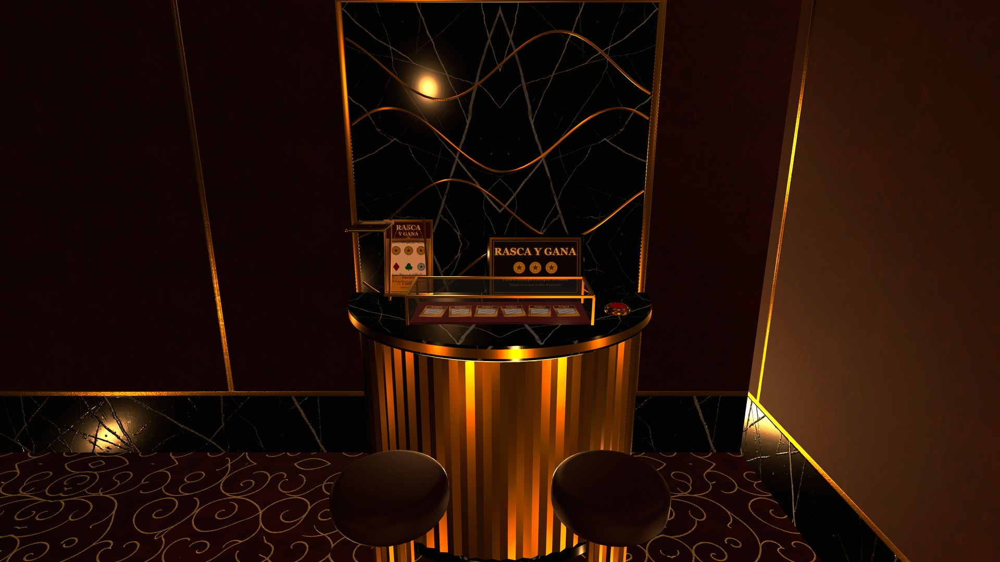
Hold **E** 1 s on a card (5, 25 or 100 chips). Hold left click to scratch box by box (double click: all). 3 alike pays
straight to your stack: ×1 to ×100, **3 crowns ×1000**. 1 card in 4 wins something. Toss it with G or in the bin.

---

## Bar and cigar cellar

### Bar
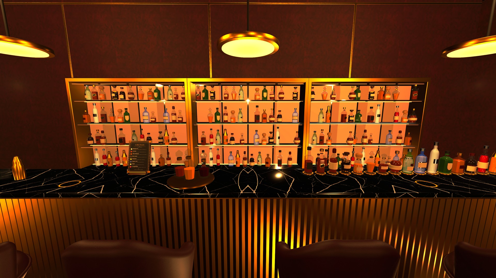
Cocktails and bottles are free at the 1st floor bar (the private club and the champagne bar on the 2nd floor have their own).
Drinks get you drunk little by little, depending on how strong they are. The special champagne is a whole bottle for 400
chips.

### Cigar cellar
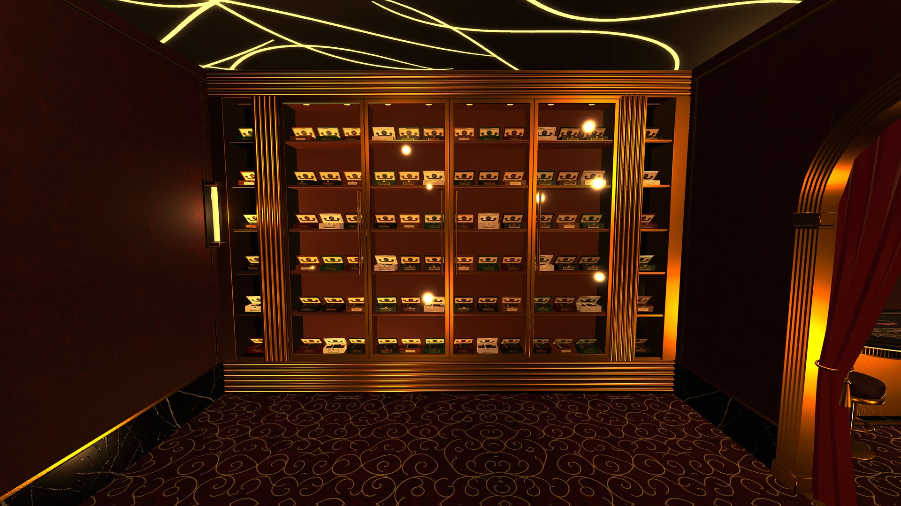
Free cigars from six house brands (Le Coque, Coque Blanc, Coque Noir, Coque Royal, Casa Coque, Coque Esmeralda). Smoke one
seated or standing.
