# Le Coque's Casino

*by LeCoqueEnRose* · **[Install from Thunderstore](https://thunderstore.io/c/lethal-company/p/LeCoqRoses/LeCoquesCasino/)** (r2modman / Thunderstore Mod Manager)

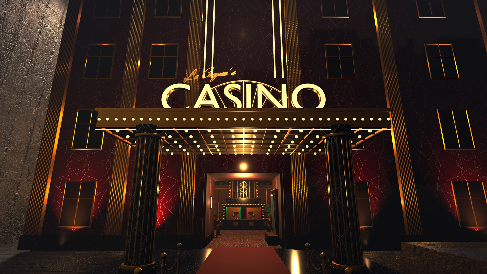

**A luxury casino built right next to the Company building.** Three floors of burgundy, brass and black marble, 19 games,
a bar, a cigar cellar and a private club, all made from scratch for Lethal Company. Bring your scrap, swap it for chips,
and try to leave richer than you came in... or bet the whole quota on the Mega Machine.

Everything is played together: every roll, card, spin and payout is decided by the host and shown identically to the whole
crew.

## Trailer

## The games

| | Game | In one line |
|---|---|---|
| 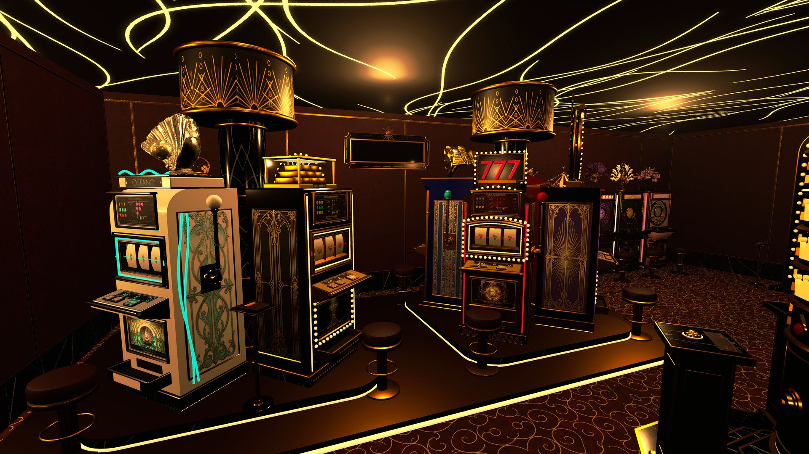 | **Slot machines** (8 themes) | Low, medium and high-grade machines; only the high grade pays the shared slots jackpot. |
| | **Wheel slot** | A medium-grade slot with a bonus wheel on top (×2 to ×50). |
| 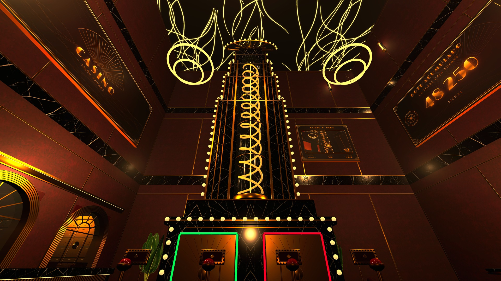 | **Mega Machine** | The whole crew pulls the levers: double or nothing on the Company quota. |
| | **Plinko** | Pick your chip, pick how many balls, and pray for the ×1000 corners. |
| 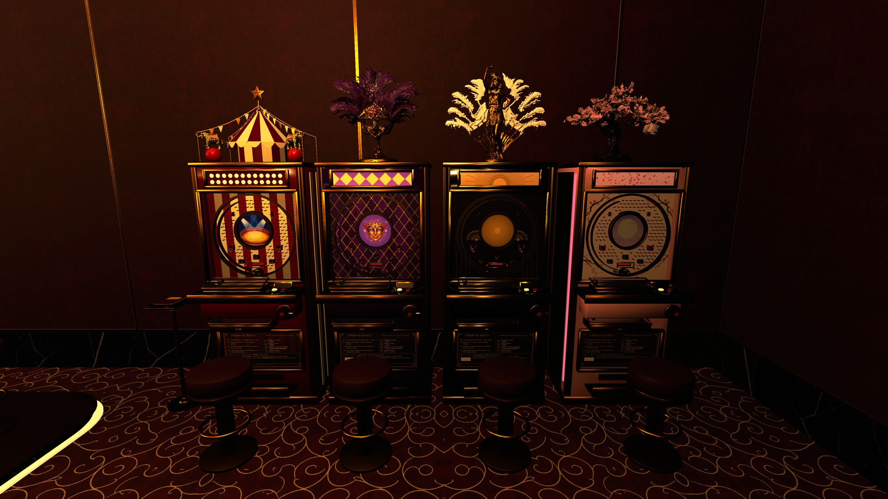 | **Pachinko** (4 machines) | Shoot balls, hit the pockets, land 7 7 7 for FEVER. |
| 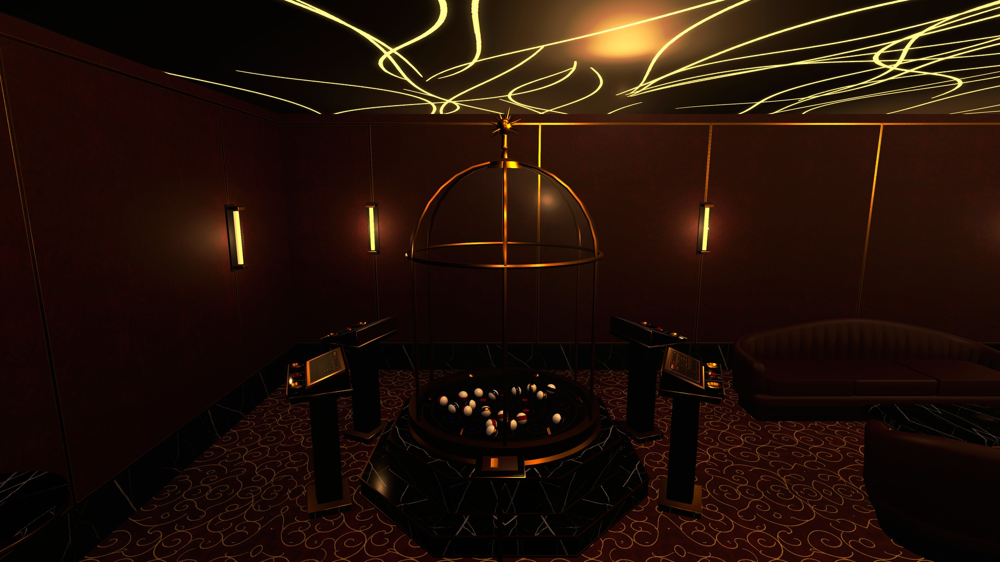 | **Bell jar bingo** | Five balls drop from the air-blown bell jar onto your symbols. |
| | **Shell game** | Five cups, one ball, follow it: the only game where the house loses to sharp eyes. |
| 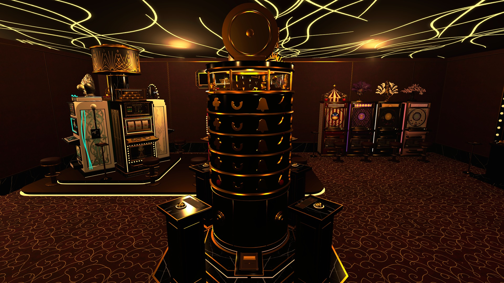 | **Vault Tower** | Stop four spinning rings with a crown on your ruby (every ring has a crown facing each table) to win the megapot, which survives getting fired. |
| 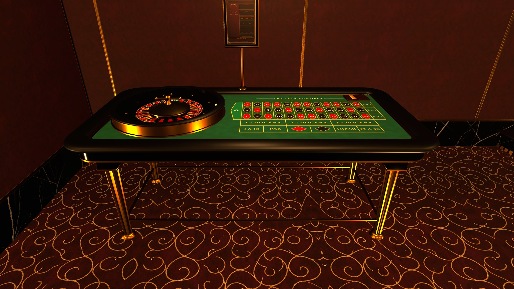 | **Roulette** | Single-zero European roulette with a full betting layout. |
| | **Craps** | The dice float to the shooter; pass line, odds, field, hardways and more. |
| 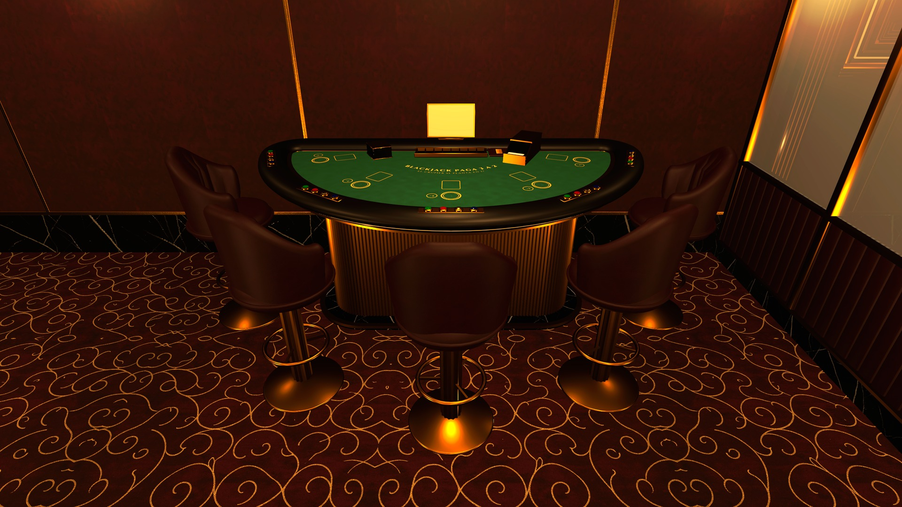 | **Blackjack** | One seat per player; hit, stand, double and split. |
| | **Sic bo** | The dice float into the cup, it shakes in the air and slams down; bet on totals, doubles and triples. |
| | **Baccarat** | Player, Banker or Tie; the cards deal themselves. |
| 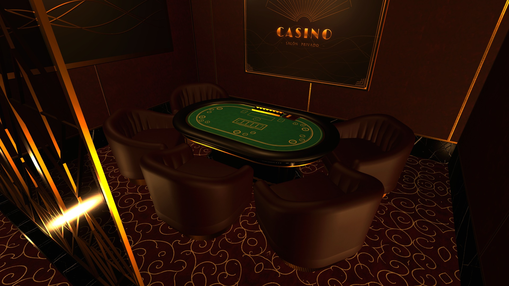 | **Poker** | Draw poker, Texas Hold'em and Coque's choice against your crew (no house cut), or Hold'em and Coque's choice against the dealer; a lever picks the opponent and the dealer's tablet the game. Everyone sees who raised and what's in the pot. |
| 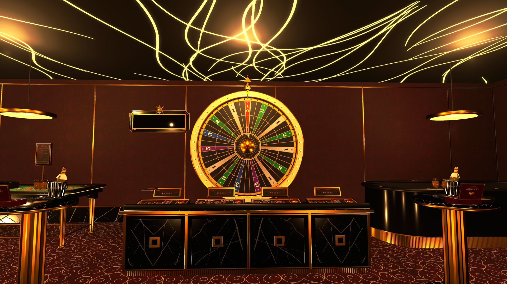 | **Big wheel** | Spin 25, 50 or 100 chips; land on GOLD for the gold jackpot. |
| | **Keno** | Mark up to 10 numbers on your console; 20 balls every two minutes. |
| 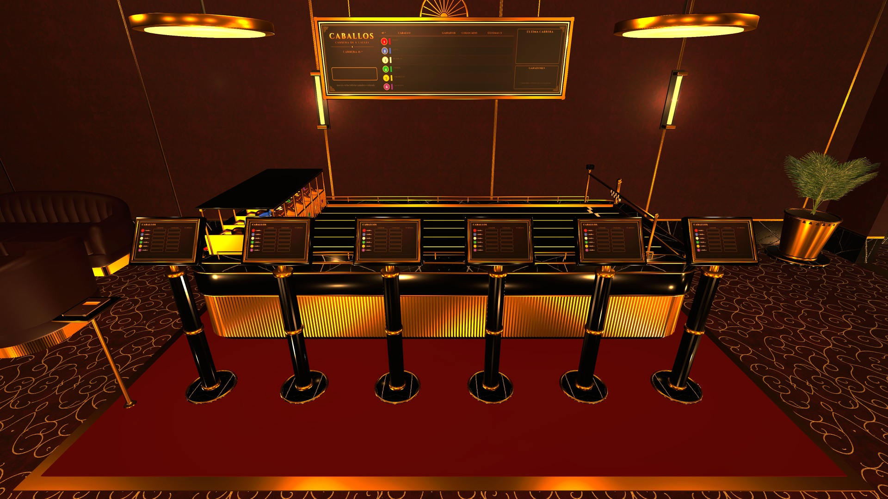 | **Horse race** | Six little horses on a glass table; bet to win or to place. |
| 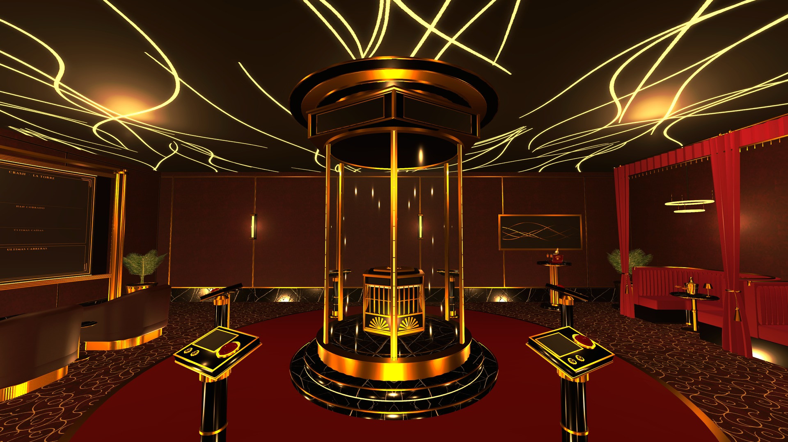 | **Crash** | The cab climbs the glass tower and the multiplier grows. Cash out before it falls. |
| | **Scratch cards** | 5, 25 or 100 chips; scratch box by box in the private club. |

**And around them:** the chip cage with its vault, a long bar with free cocktails and bottles (they really get you
drunk), a cigar cellar with six house brands (Le Coque, Coque Blanc, Coque Noir, Coque Royal, Casa Coque and Coque
Esmeralda), a champagne bar on the balcony, a jellyfish lounge, a private club with a fireplace, and an elevator between
floors. Every game has a rule card you can pick up and read (Z to bring it close), and two big screens on the 2nd floor
explain every game.

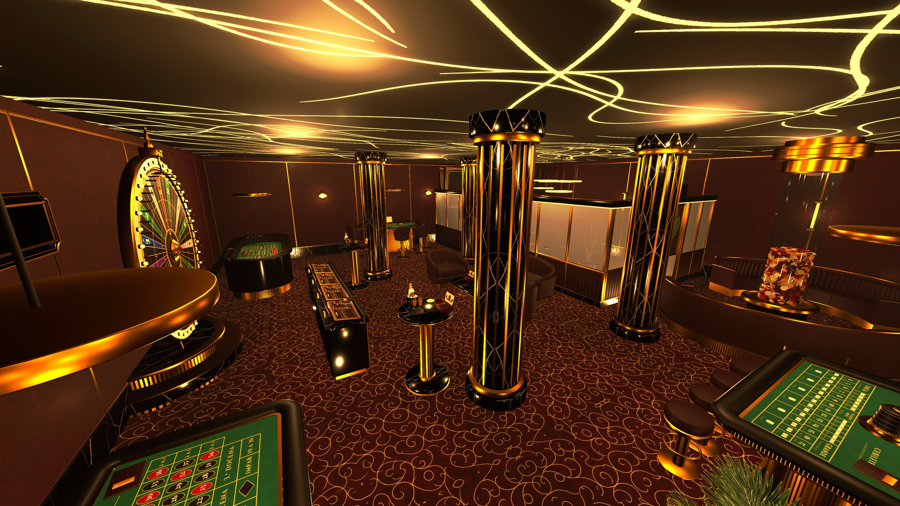

## How chips work

1. **Get chips at the cage** (ground floor, three windows: each player sees their own balance at any of them, at the same time): drop your scrap on the tray, or press E holding it. Chips are worth 100 % of
   the scrap's value: no fee.
2. **Take a chip stack** at the window (E). It takes one inventory slot. Left click changes the chip value (1, 5, 25, 100…).
3. **Play:** at any game, E places a chip and Q takes the last one back while bets are open. Y / U / I are shortcuts for
   the first, second and third option of the game in front of you.
4. **Cash out at the cage:** for credits at the Company's rate of the day (by default this counts as selling for the
   quota), or for a voucher.

Only three things have a jackpot: the high-grade slots, the big wheel's GOLD and the Vault Tower's megapot. Everything else
pays fixed odds, set close to a real casino (the house keeps 0.4 to 8 chips of every 100 depending on the game). You can
win big in an evening, and you can lose everything.

Full game guide (rules, keys and payouts of every game): **GUIDE.md**, included in the download.

## Multiplayer

- **Everyone in the lobby needs the mod** (same version). The host decides every result and sends it to everyone.
- The casino is placed when the ship lands at the Company and is removed when you leave.

## Options

With [LethalConfig](https://thunderstore.io/c/lethal-company/p/AinaVT/LethalConfig/) installed (optional) the options show up
in its in-game menu; otherwise edit `BepInEx/config/lecoqueenrose.lecoquescasino.cfg`.

| Option | Default | What it does |
|---|---|---|
| English screens | on | Screens, signs and notices in English or Spanish. Per player. |
| Top panel size | 0.6 | Size of each game's panel and result notice (0.4 to 1). Per player. |
| Full top panel | off | Off = just the game, its state and your keys; on = with explanations. |
| Win/lose notice | on | A short line with what you won or lost in your last round. |
| Shortcut keys | Y, U, I | First, second and third option of the game in front of you. |
| Zoom key | Z | Seated at poker, blackjack or sic bo, zooms in on the table. |
| Cage credits count for the quota | on | Cashing chips into credits counts as selling (host only). |
| Music / effects volume, music off, room ambience off | 1, 1, off, off | Per player. |
| Jackpots, slot machine grades, crash speed, Vault Tower difficulty | balanced | Host only. |
| Own drinking and smoking animations, flying chips and cards | on | Turn them off if another mod clashes. |

## Compatibility

- Made for **Lethal Company v81**.
- **Do not use together with LethalCasino:** this casino takes the same spot next to the Company building (and removes the
  same four shipping containers). Use one or the other.
- Only dependency: BepInExPack. LethalConfig is optional.

## Coming next

**???**

Something is being built on the floor above. Keep an eye on the elevator.

## Credits

- **Le Coque's Casino** by **LeCoqueEnRose**: design, building, models, textures and games made from scratch for this mod.
- **Music:** "In Your Arms", "Cool Vibes", "Acid Trumpet" and "Dirt Rhodes" by Kevin MacLeod (incompetech.com), licensed
  under [CC BY 4.0](https://creativecommons.org/licenses/by/4.0/) · "A Conversation with Saul" by Matthew Pablo
  (www.matthewpablo.com), [CC BY 3.0](https://creativecommons.org/licenses/by/3.0/) · "Okey Dokey Smokey" by Jason Shaw
  (audionautix.com), [CC BY 4.0](https://creativecommons.org/licenses/by/4.0/) · "Moil" by Ruskerdax (OpenGameArt), CC0.
  Tracks were edited (mono, trimmed, equalized; "Okey Dokey Smokey" slowed to 88 %).
- **Sound effects:** CC0 sounds by Kenney (kenney.nl) and many Freesound contributors (full list with authors in
  `sonidos.json`), plus the casino's own jingles.
- **Fonts used in textures:** Cinzel, Federo, Josefin Sans, Limelight, Marcellus SC, Poiret One and Herr Von Muellerhoff
  (SIL Open Font License).
